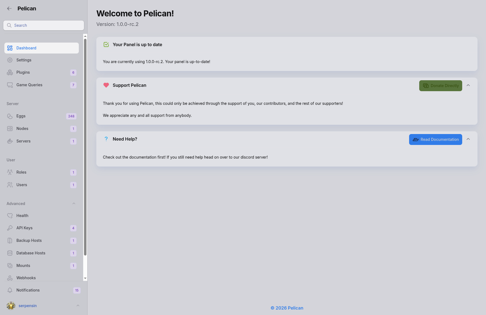
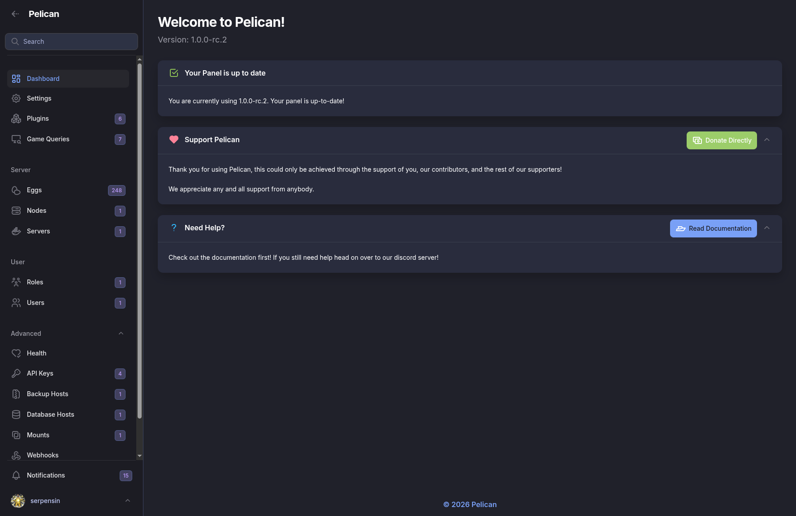

# Tokyo Night for Pelican

Tokyo Night for Pelican brings both official Tokyo Night color modes to the Panel:

- **Tokyo Night Light** follows Pelican’s light appearance mode.
- **Tokyo Night** follows Pelican’s dark appearance mode.

Use Pelican’s normal light/dark-mode control to switch between them. This theme does not add a separate toggle.

## Preview

### Tokyo Night Light



### Tokyo Night



## What changes

The theme applies the Tokyo Night palette to the Panel interface while preserving Pelican’s normal layout and behavior:

- page backgrounds, sidebar, and topbar
- cards, tables, and forms
- dialogs, tabs, badges, and notifications
- buttons, links, hover states, and keyboard-focus states

## Compatibility

- Pelican Panel `^1.0.0`

## Install

1. Place the plugin directory at:

   ```text
   plugins/serpensin-tokyo-night-theme
   ```

2. From the Pelican Panel directory, run:

   ```sh
   php artisan p:plugin:install serpensin-tokyo-night-theme
   ```

3. Open Pelican and select your preferred light or dark appearance mode.
